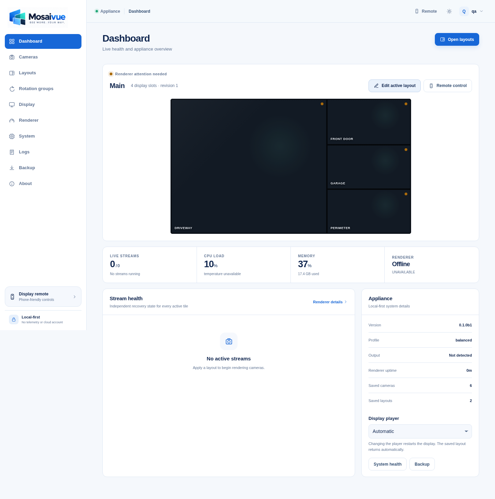
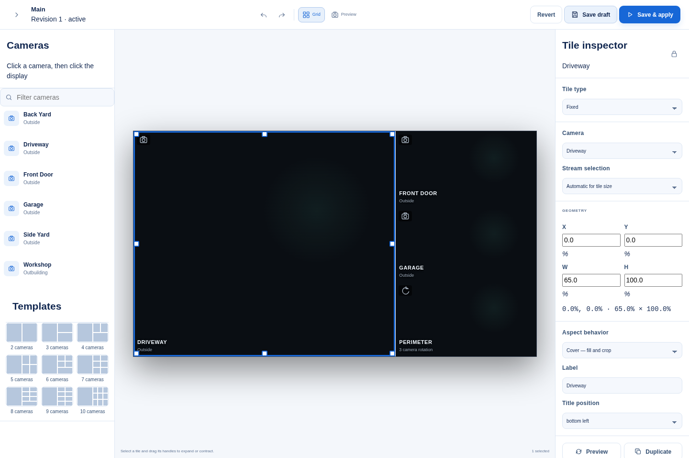
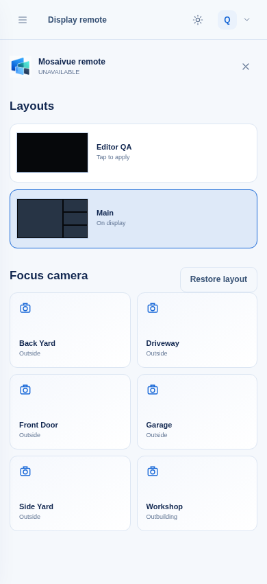

# Mosaivue

**The flexibility of displaycameras without the painful configuration.**

Mosaivue is a local-first camera-monitor appliance for Raspberry Pi and Linux. It stores cameras once, lets you place them on a visual canvas, applies layout changes to an HDMI display without rebooting, and rotates selected tiles without disturbing fixed cameras.

Mosaivue is designed for Raspberry Pi OS Lite and does not require a desktop session. The control plane, camera credentials, layouts, health data, and previews stay on the appliance. There is no required cloud account, analytics service, or telemetry.

> **Beta status:** v0.1.0b1 is staged privately. The Pi 3B+ ran a seven-feed OMXPlayer wall at 1920×1080 for over 12 days and made more than 69,000 rotation cuts; its updated renderer was still healthy after about seven days. The ROCK Pi 4B+ ran a seven-tile GStreamer/KMS wall at 1920×1080 for over four hours and made more than 1,000 cuts, but later long runs had repeated rotation stalls and renderer restarts. Its two rotating feeds now use verified RTSPS endpoints for another long-run trial. This path is not yet qualified for a public beta. These are site results, not stream-count guarantees. Raspberry Pi 4 and Pi 5 physical output and decode behavior remain unqualified. See [beta notes](docs/beta-release.md).

## What is included

- Persistent camera registry with multiple RTSP profiles per camera
- Credentials encrypted at rest with AES-256-GCM and omitted from API responses and sanitized exports. The legacy OMXPlayer backend passes a resolved stream URL to its local player process; see [security boundaries](docs/security.md).
- Reusable layouts stored in normalized coordinates, with optional pixel overrides
- Drag, resize, multi-select, align, distribute, duplicate, lock, undo, redo, copy, paste, grid snap, and exact geometry in the browser editor
- Fixed, manual/selectable, empty, and independently rotating slots
- Sequential, reverse, random, and weighted rotation groups
- Automatic source-profile selection so small tiles can use camera substreams
- GStreamer compositor with isolated per-stream branches and an OMXPlayer option for legacy Pi hardware
- Per-stream health, reconnect backoff, placeholder fallback, and independent stream restart
- Layout revision history and last-known-good activation behavior
- Focus/fullscreen camera mode with restore
- Optional schedules, phone-friendly display remote, and Server-Sent Events
- FastAPI REST API and OpenAPI documentation
- CLI and Textual TUI
- Raspberry Pi/Linux capability detection, diagnostics, benchmark, optimizer recommendations, and sanitized support bundles
- Sanitized configuration export plus passphrase-encrypted complete backups
- `displaycameras` configuration migration with dry-run reporting
- Idempotent installer, conservative uninstaller, update helper, systemd hardening, source releases, and Debian packaging scripts
- Unit, integration, API, renderer-contract, migration, backup, and frontend tests

Browse the [documentation index](docs/index.md) for installation, camera setup, layouts, rendering, security, and beta qualification.

## Screenshots

### Appliance dashboard



### Drag-and-resize layout editor



### Phone display remote



Regenerate these from a demo or test appliance with:

```bash
MOSAIVUE_SCREENSHOT_USER=demo \
MOSAIVUE_SCREENSHOT_PASSWORD='your-local-password' \
MOSAIVUE_SCREENSHOT_URL=http://127.0.0.1:8080 \
./scripts/capture-screenshots.sh
```

## Supported targets

| Platform | Intended support | Notes |
|---|---|---|
| Raspberry Pi 5, 64-bit Raspberry Pi OS Lite | Primary | DRM/KMS or GL/Wayland sink selected from detected capabilities |
| Raspberry Pi 4, 64-bit Raspberry Pi OS Lite | Primary | Prefer H.264 substreams where that best matches available decode support |
| Raspberry Pi 3B+ with Bullseye 32-bit and OMXPlayer | Tested beta path | One site ran seven live feeds at 1920×1080 for over 12 days; other camera mixes need measurement |
| ROCK Pi 4B+ | Tested beta path | Debian 12 arm64, Rockchip MPP, `kmssink`: one seven-tile real-camera wall ran at 1920×1080 for over four hours; cold starts and other camera mixes still need qualification |
| Debian/Ubuntu ARM64 | Supported | Hardware decode depends on board and installed GStreamer plugins |
| Debian/Ubuntu x86_64 | Supported | Useful for development and Intel/AMD appliance builds |

Mosaivue never hard-codes a stream-count promise. Run `mosaivue benchmark` and follow `docs/performance.md` on the actual appliance.

## Clean installation

For a published beta release, download the bootstrap installer and run it:

```bash
sudo apt-get update && sudo apt-get install -y curl ca-certificates && curl -fsSLo mosaivue-install.sh https://raw.githubusercontent.com/the-vibe-dev/mosaivue/main/install.sh && sudo bash mosaivue-install.sh
```

It downloads a versioned source release, verifies its SHA-256 checksum, and runs the local installer. The automatic installer supports Debian and Raspberry Pi OS 12+, Ubuntu 24.04+, and legacy 32-bit Raspberry Pi OS 11 with an existing OMXPlayer installation. It needs `sudo`, internet access for packages, and a systemd host. See [installation requirements and rollback](docs/install.md).

To install a source archive directly:

```bash
tar -xzf mosaivue-0.1.0b1-source.tar.gz
cd mosaivue-0.1.0b1
sudo ./install.sh
```

Useful options:

```bash
sudo ./install.sh --non-interactive
sudo ./install.sh --no-start
sudo ./install.sh --bind 127.0.0.1
sudo ./install.sh --dev
```

The normal appliance install explicitly binds the web server to the LAN (`0.0.0.0`) and prints that decision. Use `--bind 127.0.0.1` for reverse-proxy-only or local administration.

The installer prints the detected display, renderer report, web URL, and one-time setup token. Open the URL, enter the token, and create the first administrator.

```text
Mosaivue installed successfully.

  Web setup:    http://192.168.1.50:8080
  Setup token:  MV-XXXXXX-XXXXXX-XXXXXX
  Terminal UI:  sudo -u mosaivue mosaivue tui
  Diagnostics:  mosaivue doctor
```

The bootstrap script can be inspected before the `sudo bash` step. Published beta releases are required for anonymous downloads; private staging uses the source archive.

## First camera wall

1. Open **Cameras**, select **Add camera**, and enter an RTSP or RTSPS URL.
2. Use **Test stream** to inspect connection time, codec, resolution, transport, decoder selection, and time to first frame.
3. Add lower-resolution substreams when the camera exposes them.
4. Open **Layouts**, create a layout, and drag saved cameras onto the canvas.
5. Resize or position the tiles, choose `contain`, `cover`, `stretch`, or `native`, then select **Save & Apply**.
6. Create a **Rotation group**, choose its cameras and interval, and assign it to one slot. Fixed slots remain in place while that slot rotates.

## Migrate displaycameras

Preview the import first:

```bash
sudo mosaivue migrate displaycameras --dry-run
```

Apply it after reviewing warnings:

```bash
sudo mosaivue migrate displaycameras
```

Custom paths can be supplied more than once:

```bash
sudo mosaivue migrate displaycameras \
  --source /etc/displaycameras/displaycameras.conf \
  --source /etc/displaycameras/layout.conf.1920x1080
```

The migration reads camera arrays, RTSP URLs, rectangles, and resolution hints; creates reusable cameras; converts pixels to normalized geometry; and leaves the original files untouched.

## CLI examples

```bash
mosaivue status
mosaivue doctor --json
mosaivue camera list
mosaivue camera add --name Driveway --url 'rtsp://192.168.1.20/stream'
mosaivue camera edit CAMERA_ID --name "Front Door"
mosaivue camera test CAMERA_ID
mosaivue layout create --name Night
mosaivue layout list
mosaivue layout export LAYOUT_ID night-layout.json
mosaivue layout import night-layout.json --name "Night Copy"
mosaivue layout activate LAYOUT_ID
mosaivue rotation stop GROUP_ID
mosaivue renderer status --json
mosaivue benchmark --streams 6 --width 1920 --height 1080
mosaivue backup --output mosaivue-sanitized.zip
mosaivue backup --include-credentials --output mosaivue-complete.cwbackup
mosaivue support-bundle
mosaivue config validate
mosaivue security audit
mosaivue tui
```

## Services and logs

```bash
systemctl status mosaivue-renderer.service mosaivue-server.service
journalctl -u mosaivue-renderer.service -f
journalctl -u mosaivue-server.service --since '1 hour ago'
```

The renderer and API are separate processes. A renderer crash does not remove the web control plane, and systemd restarts it independently.

## Configuration and data

| Path | Purpose |
|---|---|
| `/etc/mosaivue/config.json` | Non-secret application settings |
| `/etc/mosaivue/master.key` | Local credential-encryption key, mode `0640` and readable only by root and the dedicated `mosaivue` group |
| `/etc/mosaivue/setup-token` | One-time setup token; deleted after use |
| `/etc/mosaivue/install-prefix` | Installation root used by update and uninstall helpers |
| `/var/lib/mosaivue/mosaivue.db` | SQLite configuration database |
| `/var/lib/mosaivue/capabilities.json` | Last hardware/renderer capability report |
| `/run/mosaivue/renderer.sock` | Local renderer RPC socket |
| `/var/log/mosaivue/` | Installer/diagnostic logs; runtime logging uses journald |

## Development

```bash
python3 -m venv .venv
. .venv/bin/activate
pip install -e '.[dev]'
cd frontend && npm run build && cd ..
cp -a frontend/dist src/mosaivue/static
pytest
./scripts/dev.sh
```

GObject introspection and GStreamer are installed through the operating system. On Debian/Raspberry Pi OS, use a virtual environment created with `--system-site-packages` so PyGObject can use the distribution GStreamer bindings.

## Hardware qualification

The project includes a synthetic compositor benchmark and a [hardware test plan](docs/hardware-test-plan.md). A Pi 3B+ OMXPlayer wall and a ROCK Pi 4B+ GStreamer/KMS wall have site-specific results. The automated build environment has no physical display. Raspberry Pi 4 and Pi 5 still need measured output and decode results before hardware claims.

## Security and privacy

- The web UI requires initial setup and authentication.
- Sessions use HttpOnly, SameSite cookies; state-changing requests require CSRF tokens.
- Passwords use scrypt; RTSP secrets use AES-256-GCM with per-record authenticated context.
- RTSP passwords are not returned to the browser after saving.
- Support bundles and default exports are sanitized and covered by automated redaction tests.
- The backend accepts RTSP/RTSPS URLs only and does not expose a generic unauthenticated URL fetcher.
- OMXPlayer receives the resolved camera URL as a process argument. Limit local shell access to trusted operators and use read-only camera accounts.
- No telemetry or cloud account is present.

See `SECURITY.md` and `docs/security.md` before exposing Mosaivue beyond a trusted LAN. HTTPS is expected at a reverse proxy for untrusted networks.

## Uninstall

```bash
sudo mosaivue uninstall
```

Application files are removed, while configuration and the database are preserved unless you explicitly choose to delete them. Non-interactive purge is available as `sudo ./uninstall.sh --purge`.

## License

Mosaivue core is licensed under Apache-2.0. No source from OMXPlayer is included. A future OMXPlayer-derived legacy component must remain isolated and separately GPL-licensed. See `NOTICE` and `THIRD_PARTY_NOTICES.md`.
